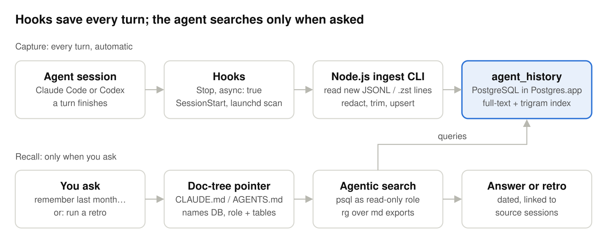

# Persistent Agent Session Memory — Proposal

Nov 16, 2026 · @Akim @gmail

## Summary

Build a permanent, searchable store of every Claude Code and Codex session, saved by lifecycle hooks into one local PostgreSQL database (Postgres.app on this Mac), so an agent can answer "remember last month…" and run project retrospectives. The agent learns the database exists from a one-line pointer in CLAUDE.md / AGENTS.md (progressive disclosure) and searches it with plain tools: `psql` with PostgreSQL full-text search (`tsvector` + GIN) and trigram matching (`pg_trgm`), plus grep over optional markdown exports. No embeddings and no extra service beyond the Postgres.app server that already runs at login. The capture code is a small Node.js CLI in plain JavaScript, using Knex for PostgreSQL. Expected effort: about one day for a working first version.

## Problem

Agent history disappears, and what survives cannot be searched across projects.

- **Claude Code deletes transcripts after 30 days by default.** The `cleanupPeriodDays` setting deletes session files older than the limit at every startup ([settings note](https://brycewatson.com/blog/28-claude-code-deletes-old-logs)). Many issue reports describe silent loss, including one of about 950 sessions ([issue](https://claudeissues.com/issue/85466-default-30-day-cleanupperioddays-silently-hard-deleted-950-session-transcripts-n)).
- **Transcripts are scattered.** They sit as one JSONL file per session, per project folder (`~/.claude/projects/…`, `~/.codex/sessions/…`), full of raw tool output.
- **No recall.** A new session knows nothing about past ones, so decisions and their reasons must be re-explained or are lost.

## Goals and non-goals

**Goals**

1. Keep every session forever, with nothing deleted or archived away by the tools' own cleanup.
2. Capture Claude Code and Codex sessions into one schema, across all projects.
3. Let the agent find a past conversation by date, project, file or keyword in seconds.
4. Support retrospectives: summarise what happened in a project over a date range.
5. Add zero noticeable delay to normal sessions.

**Non-goals (v1)**

- Semantic or vector search.
- A UI or web dashboard.
- Syncing across machines or sharing with a team.
- Automatically injecting memories into every session.

## Proposed approach

A small Node.js ingest CLI, called by hooks after every turn, copies each session into one PostgreSQL database on the local Postgres.app server; the agent reads it only when a question needs history.



The top row runs on every turn without anyone noticing; the bottom row runs only when you ask about the past.

**Components**

1. **Hook config.** Claude Code in `~/.claude/settings.json`, Codex in `~/.codex/hooks.json`. `Stop` (async) runs `agent-history ingest`; `SessionStart` runs a catch-up scan for sessions not fully saved.
2. **Ingest CLI (Node.js).** `agent-history`, run with an absolute `node` path. Reads the hook's stdin JSON (`session_id`, `transcript_path`, `cwd`, `last_assistant_message`), reads the transcript from the last saved offset, redacts secrets, trims tool output and upserts rows with Knex (`insert().onConflict().merge()`, on top of the `pg` driver).
3. **Schema.** Database `agent_history`: `sessions` (id, tool, project, cwd, started\_at, ended\_at, title, transcript\_path) and `messages` (id, session\_id, ts, role, text, tool\_name, files), with a generated `tsvector` column over the text, a GIN index on it, and a trigram GIN index for substring search (paths, identifiers, error strings).
4. **Markdown export (optional).** One file per session at `~/.agent-history/md/<project>/<date>-<id>.md`, so grep, ripgrep and tree work as in the original post.
5. **Doc-tree pointer.** A few lines in the global CLAUDE.md / AGENTS.md, written as plain facts:

```markdown
## Past sessions
All Claude Code and Codex sessions are stored in PostgreSQL database agent_history (Postgres.app, localhost:5432).
Query read-only: "/Applications/Postgres 18.app/Contents/Versions/latest/bin/psql" --dbname="postgresql://agent_history_reader@localhost:5432/agent_history"
Tables: sessions, messages (text_tsv for full-text over the first 100,000 chars; ILIKE on text for longer ones). Filter by project and date first, then search text.
Markdown copies: ~/.agent-history/md/<project>/
```

6. **Retrospective command.** A saved prompt (slash command or skill) that pulls a project's sessions for a date range and writes a summary of decisions, reversals and open threads.

## Key design decisions

| Decision | Options | Recommendation |
| --- | --- | --- |
| Capture event | Stop (each turn), SessionEnd, PreCompact | Stop as the main trigger, plus a SessionStart catch-up pass. SessionEnd gets only a 1.5 s budget and the transcript can already be gone ([hooks docs](https://code.claude.com/docs/en/hooks), [issue](https://claudeissues.com/issue/30217-sessionend-hook-transcript-file-deleted-before-hook-can-read-it)) |
| Final answer source | Read transcript file, use `last_assistant_message` | `last_assistant_message`: the transcript is written asynchronously and can lag the current turn |
| Ingestion style | Copy whole file each time, incremental by byte offset | Incremental: store the last read offset per session, upsert by message UUID |
| What to store | Everything, prompts + answers only, middle ground | Prompts, final answers, tool names, touched file paths, timestamps; tool output trimmed to \~500 chars |
| Search | `ILIKE`, full-text (`tsvector`), trigram (`pg_trgm`), vectors (`pgvector`) | Full-text with `websearch_to_tsquery` and `ts_rank` for words, `pg_trgm` for substrings and identifiers; no embeddings in v1; optional per-session markdown export for grep/tree |
| Discovery | Always inject history, pointer only | Pointer only: a 3–5 line note in CLAUDE.md / AGENTS.md, so context costs nothing until asked |
| Hook mode | Synchronous, async | `async: true` so sessions never wait on the database |
| Store | SQLite file, local PostgreSQL | PostgreSQL in the Postgres.app server already running at login: real concurrent writers, full-text and trigram search, `psql` and GUI clients; one database `agent_history` with a `project` column |
| Language | Python, Node.js, Go | Node.js, plain JavaScript (ES modules, no build step); Knex as the query builder and migration tool over the `pg` driver; Node reads `.zst` natively |
| Retention | Raise `cleanupPeriodDays` too, or not | Both: raise it as a backstop and keep the DB as the source of truth |

## Risks and mitigations

| Risk | Impact | Mitigation |
| --- | --- | --- |
| Secrets in transcripts (API keys, `.env` contents) | High: one database holds every secret ever pasted | Redact known key patterns on ingest; data dir is 0700; agent queries through a read-only role; exports, logs and backups 0600; keep dumps out of git and cloud sync |
| Transcript lag or missing file at capture time | Lost or stale last turn | Use `last_assistant_message`; re-scan unfinished sessions at the next SessionStart |
| Database bloat from tool output | Slow search, large database | Trim tool output, store file paths not contents; autovacuum; watch size in `doctor` |
| Postgres.app not running, or upgraded to a new major version | Hooks fail; a new major version starts with an empty data dir | Hooks fail open and log; recovery scan catches up once the server is back; regular `pg_dump` backups; `doctor` checks server version and DB presence |
| Postgres.app permission dialog blocks a headless client | launchd scan or hook is denied with no one to click Allow | Run every client through one pinned absolute `node` path that is already allowed; `doctor` and the recovery scan surface connection denials |
| Weak recall on vague asks ("that auth thing") | Agent misses the right session | Date and project filters first; the agent retries with synonyms; add a short per-session summary later |
| Stale decisions resurfacing | Agent repeats a choice that was reversed | Always show dates; newer sessions win; retros list reversals |
| Transcript format changes between tool versions | Ingest breaks silently | Keep the raw JSONL line in a column; log parse errors; pin a parser version |
| Hook security | Hooks run with full user rights | Exec form with quoted paths; treat hook input as untrusted; never `eval` it |
| Concurrent sessions writing at once | Duplicate rows or lost checkpoints | PostgreSQL row locking; one short transaction per batch; checkpoint compare-and-set; one connection per hook process |

## Success criteria

- [ ] 100% of sessions from both tools appear in the DB within one turn of finishing.
- [ ] A session older than 30 days is still fully searchable after Claude Code's cleanup has run.
- [ ] "Remember last month, when we…" finds the right session in 3 or fewer agent queries in at least 8 of 10 test asks.
- [ ] A project retrospective for a 30-day range is produced from the DB in one request.
- [ ] Hooks add under 50 ms of visible delay per turn (async).
- [ ] A scan of the DB finds no unredacted API keys from a seeded test set.

## Open questions for the implementation plan

- [ ] Which tools are in scope for v1: Claude Code only, or Codex too?
- [ ] Which OS and machines: one laptop, or several that should merge?
- [x] Language for the hook script: Node.js. Store: PostgreSQL via Postgres.app on this Mac.
- [ ] Should existing transcripts be backfilled before the 30-day cleanup removes more?
- [ ] Store subagent transcripts, or only the main session?
- [ ] Add an LLM-written one-paragraph summary per session (costs tokens, improves recall)?
- [ ] Redaction: a regex list only, or also an allowlist of fields to keep?
- [ ] Expose search as a skill or slash command (`/recall`) in addition to the CLAUDE.md pointer?
- [ ] Where the post's retrospective prompt fits: a saved command, or a skill?

## Sources

- [Claude Code hooks reference](https://code.claude.com/docs/en/hooks)
- [Codex hooks best practices](https://github.blesdmm.dns-dynamic.net/shanraisshan/codex-cli-best-practice/blob/main/best-practice/codex-hooks.md)
- [Claude Code deletes your old session logs after 30 days](https://brycewatson.com/blog/28-claude-code-deletes-old-logs)
- [SessionEnd hook: transcript file deleted before hook can read it](https://claudeissues.com/issue/30217-sessionend-hook-transcript-file-deleted-before-hook-can-read-it)
- [Postgres.app documentation](https://postgresapp.com/documentation/)
- [PostgreSQL full-text search](https://www.postgresql.org/docs/current/textsearch.html)
- [Default cleanupPeriodDays hard-deleted \~950 transcripts](https://claudeissues.com/issue/85466-default-30-day-cleanupperioddays-silently-hard-deleted-950-session-transcripts-n)
